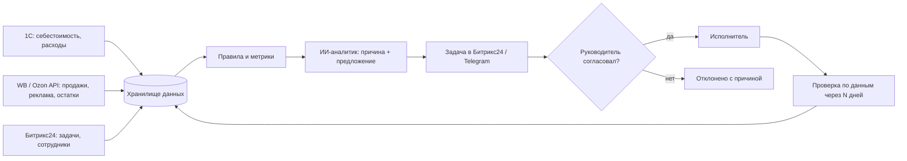

# «Натурпласт»: система управления бизнесом с ИИ — тестовое задание

Автор: Рамиль Сабантуев, AI Solution Architect / инженер по автоматизации бизнес-процессов.
Формат: две страницы. На что опираюсь, отмечено у каждого пункта: личный опыт, подтверждённое внедрение или демонстрация продукта.

## 1. Два ориентира

### Ориентир А. Битрикс24: BI-конструктор + BitrixGPT + задачи (готовая связка)
- Ссылки: https://www.bitrix24.ru/features/bi/ · https://www.bitrix24.ru/features/copilot/ · https://www.bitrix24.ru/features/tasks/
- Что делает: BI-конструктор строит отчёты по датасетам CRM, задач и внешних источников с настройкой прав. BitrixGPT помогает в CRM, задачах и ленте: резюме звонков и переписки, черновики, заполнение карточек. Задачи с контролем сроков, канбаном и отчётами закрывают исполнение.
- Роль ИИ: помощник внутри процессов (тексты, резюме, подсказки). Сам поиск отклонений в цифрах ИИ здесь не делает: это правила и отчёты.
- Что перенять: Битрикс24 у «Натурпласта» уже есть. Задачи, ответственные, сроки и права живут там, и сотрудникам не придётся учить новый интерфейс. Контур «увидел → поручил → проконтролировал» замыкается в одной системе.
- Ограничения: в Битрикс24 нет полной финансовой картины. Себестоимость, остатки и юнит-экономика маркетплейсов лежат в 1С, WB и Ozon, их нужно подтягивать отдельно. Ассистент не сравнивает периоды и не объясняет причины отклонений.
- На что опираюсь: личный опыт. Я с нуля спроектировал и веду операционный контур на Битрикс24 (20+ бизнес-процессов, задачи, отчёты) для сети из 10 кафе. Возможности BitrixGPT и BI-конструктора знаю по демонстрации продукта.

### Ориентир Б. Моё внедрение: AI-контроль операционки в сети «Сытый Дядя»
- Визуал: портфолио с кейсом и видео-демо https://portfolio-production-c6c9.up.railway.app (раздел кейсов, «Сытый Дядя»).
- Что делает: внутреннее приложение для 50+ сотрудников на Битрикс24, iiko и Telegram. Ежедневные отчёты сотрудников (50 в день) проверяет ИИ: сдан ли отчёт, полон ли он, что видно на фото. Ошибки подсвечиваются, отчёт без ошибок принимается. В той же системе контроль колл-центра и уборки, поставщики и автозаказы по расписанию, Telegram-бот заказов (1000+ в месяц). AI-агенты мониторят интеграции, чинят типовые сбои и передают человеку то, что не смогли исправить.
- Роль ИИ: первичная проверка и поиск отклонений. Решение и наказание остаются за человеком, ИИ только готовит факт и рекомендацию.
- Что перенять: цикл «правило → проверка ИИ → задача ответственному → повторная проверка». Человек видит только исключения, а не все данные подряд.
- Ограничения: это операционный, а не финансовый контур. 1С и маркетплейсов там не было, данные другие. Перенос подхода — да, перенос кода — нет.
- На что опираюсь: подтверждённое внедрение, мой личный проект. Работает с 2025 года.

Как связаны процессы управления в обоих ориентирах: данные → правило или метрика → отклонение → задача с ответственным и сроком → проверка результата по тем же данным. Без последнего шага получается не управление, а просто дашборд.

## 2. Предлагаемый вариант для «Натурпласта»

### Что взять готовым, что связать, что доработать
- Готовое: Битрикс24 (задачи, сотрудники, права, BI-конструктор как витрина для руководителя), 1С как источник учёта, кабинеты и API WB и Ozon, сервисы аналитики маркетплейсов, которые уже используются.
- Связать: единое хранилище данных (PostgreSQL или ClickHouse) с ежедневной выгрузкой продаж, остатков, рекламы и комиссий маркетплейсов, себестоимости и расходов из 1С, задач из Битрикс24. Справочник товаров с единым артикулом — без него ничего не сойдётся.
- Доработать: слой правил и ИИ-аналитик. Правила ищут отклонения (маржа SKU ниже порога, ДРР вырос, остатков меньше чем на N дней, просрочены задачи). LLM объясняет причину на данных, предлагает действие и создаёт задачу в Битрикс24 через REST.

### Как пользуются
- Руководитель: утренняя сводка в Telegram или Битрикс24 — 5–10 главных отклонений за сутки с деньгами под риском, кнопки «согласовать / изменить / отклонить». Раз в неделю — дашборд прибыльности и исполнения задач.
- Сотрудники (менеджеры маркетплейсов, закупка, маркетинг): получают задачи в привычном Битрикс24 с объяснением, откуда взялась задача и какую цифру нужно изменить.
- Эффективность команды видна по факту: сколько задач из сигналов выполнено в срок и какой эффект дали.

### Сценарий целиком
1. Обнаружение: за 7 дней маржа SKU «Х» на Ozon упала с 18 % до 6 %, продажи в штуках на месте.
2. Предложение: ИИ раскладывает причину по данным — выросли ставки рекламы (ДРР с 9 % до 17 %) и логистика. Он предлагает снизить ставку по двум кампаниям и поднять цену на 4 %, с ожидаемым эффектом в рублях.
3. Согласование: руководитель нажимает «согласовать» в сводке. В Битрикс24 создаётся задача менеджеру Ozon со сроком 1 день.
4. Выполнение: менеджер меняет ставки и цену и закрывает задачу с комментарием.
5. Проверка: через 7 дней система сравнивает маржу и продажи с базой и пишет в задачу результат — «маржа 13 %, продажи −3 %, эффект +N ₽». Если эффекта нет, создаётся повторный сигнал.

### Первый пилот (4–6 недель)
- Что проверяем: один маркетплейс (Ozon или WB), 30–50 ключевых SKU, три правила (маржа, ДРР, остатки) и сквозной цикл «сигнал → задача → проверка».
- Критерии пользы: доля сигналов, которые руководитель признал полезными (цель — от 60 %); доля задач, выполненных в срок; измеренный эффект в рублях по закрытым сигналам; сколько часов в неделю руководитель тратит на разбор цифр — до и после.
- Главный риск: качество и согласованность данных — артикулы 1С и маркетплейсов, корректная себестоимость. Если себестоимость неверна, ИИ будет уверенно советовать неправильное. Поэтому первые две недели пилота уходят на сверку данных.
- Вопросы, без которых нельзя двигаться дальше: где сейчас считается себестоимость и насколько ей доверяют; есть ли доступы к API WB и Ozon и к выгрузкам из 1С; кто будет владельцем решений по сигналам; какие 3–5 решений руководитель принимает чаще всего и на каких данных; какие сервисы аналитики уже оплачены и что из них можно забирать по API.

Честно о моём опыте: интеграции Битрикс24, iiko, REST API, вебхуки, Telegram-боты и ИИ-проверки в живом процессе — мой ежедневный опыт. Интеграций с 1С и API маркетплейсов на проде у меня не было: это ближайший по сложности, но новый для меня участок, и в пилоте я закладываю на него отдельное время.
